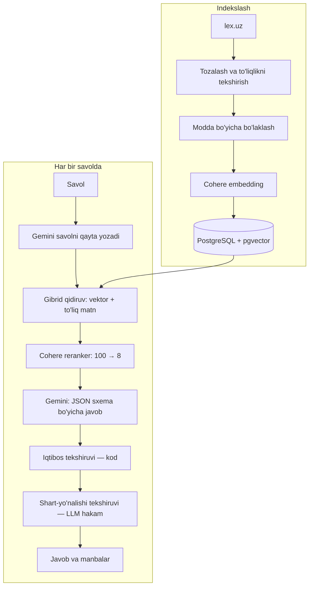

# Yurist-AI — O'zbekiston qonunchiligi bo'yicha RAG bot

Oddiy odam huquqiy savolini o'z so'zi bilan yozadi, bot esa javobni **qonun moddasiga tayanib**, manbasi bilan
beradi. Telegram bot: [@tezkoryurist_bot](https://t.me/tezkoryurist_bot)

> Kod yopiq, chunki bu ishlab turgan mahsulot. Bu sahifada arxitektura, qarorlar va o'lchovlar yozilgan.
> Jamoa 2 kishi, men RAG qismiga mas'ulman: indekslash, qidiruv, javob tekshiruvi va sifatni o'lchash.

## Raqamlarda

- **880** hujjat, **44 000** bo'lak, **200+** foydalanuvchi
- Qidiruv: **100** nomzoddan reranker bilan **8** ta
- Modda **recall@8 = 85%** (71 savollik o'lchov to'plamida)

## Arxitektura

## Asosiy qarorlar

- **Bo'lak = modda.** Savol odatda bitta moddaga tegishli, iqtibos ham modda raqami bilan beriladi. Uzun modda
  2 500 belgidan bo'linadi (overlap 200), davomiga modda sarlavhasi qo'shiladi. Sarlavhasiz bo'lak yolg'iz
  topilganda u qaysi moddaligi noma'lum bo'lib, xato javobga sabab bo'lgan.
- **Gibrid qidiruv.** Vektor qidiruv ma'noni («oylik» ≈ «иш ҳақи»), to'liq matnli qidiruv aniq atama va raqamni
  topadi. Reranker ishlamay qolsa, ikkala ro'yxat RRF bilan birlashtiriladi.
- **Lug'at jarligi.** Odam «ikkinchi xotin» deydi, qonunda «ko'p xotinli bo'lish» yozilgan. Asosiy kodekslarning
  moddalariga oddiy odam tilidagi qidiruv taxalluslari yaratilgan (doc2query). Javob esa doim modda matniga tayanadi.
- **Inkremental yangilash.** Haftada bir marta lex.uz tekshiriladi. Faqat sha256'i o'zgargan hujjat qayta
  indekslanadi: eski bo'laklar o'chirilishi va yangilari yozilishi bitta tranzaksiyada. Parallel ishga tushmasligi
  uchun Redis lock.

## Gallyutsinatsiyaga qarshi ikki qavat

1. **Kod.** Model keltirgan modda raqami topilgan kontekstda bo'lmasa, iqtibos to'qilgan deb tashlanadi.
   Foydalanuvchiga ko'rsatiladigan modda matni modeldan emas, manbadan olinadi.
2. **LLM hakam.** Javob asl modda matni bilan yonma-yon solishtiriladi. Real holat: qonun «ancha **katta** miqdor»
   degan, javob «**kichikroq** belgilanishi mumkin» degan. Modda to'g'ri, sharti teskari, buni 1-qavat ushlay
   olmaydi. Zidlik topilsa, javob bir marta qayta yoziladi.

## Sifat qanday o'lchanadi

- **71 ta savol**: hammasida kutilgan qonun, 27 tasida aniq modda belgilangan. Yurist belgilagan real savollar
  alohida qo'shiladi.
- Asosiy metrika **recall@8** (hujjat va modda bo'yicha), rerankerli va rerankersiz solishtiriladi.
- Prod'da topilgan xato tuzatilgach, o'lchov to'plamiga qo'shiladi, xato qaytsa darhol ko'rinadi.
- **Real holat:** kod o'zgarmagan, korpus o'sgan. 20 nomzodda kodeks moddalari yangi qonunlar orasida «cho'kib»
  ketdi: modda recall **85% → 69%**. Nomzodlar 100 taga oshirilgach, 85% ga qaytdi.

**Cheklov:** to'plam kichik. U katta pasayishni ushlaydi, lekin 2–3 foizlik farqni ajrata olmaydi. Javob matnining
sifati oldindan avtomatik baholanmaydi, bu keyingi qadam.

## Infratuzilma

- Docker Compose: bot, admin, payments, Caddy, PostgreSQL, Redis
- GitHub Actions: ruff, pyright, migratsiyalar, testlar va SSH orqali deploy
- Redis: so'rov cheklovi, kesh va lock
